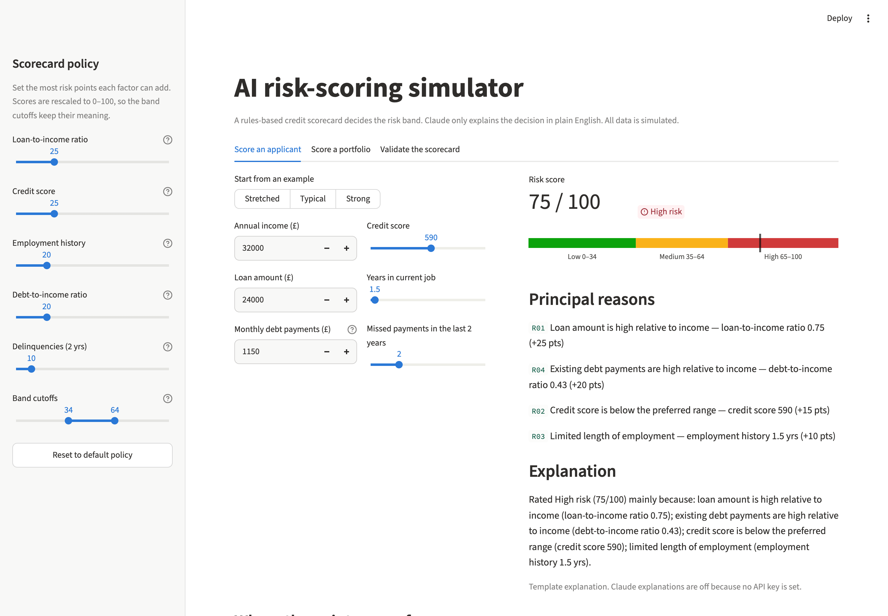
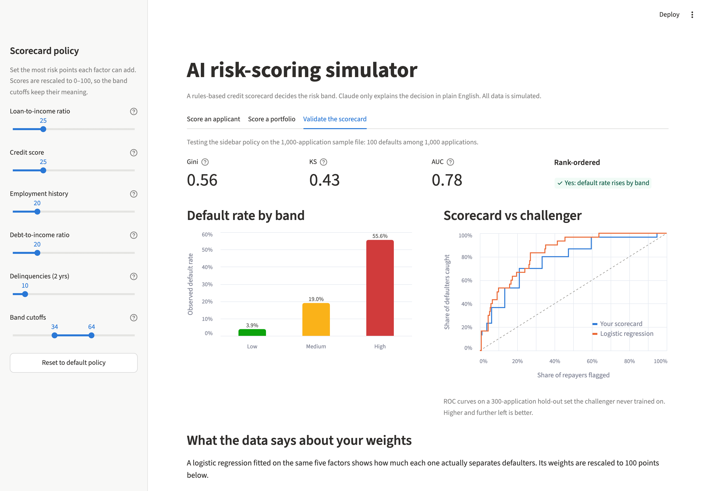

# AI Risk-Scoring Simulator

[](https://github.com/adityaarakeri-max/ai-risk-scoring-simulator/actions/workflows/ci.yml)


A small credit-risk scoring tool built the way a lending team would want it: a
transparent, rules-based scorecard makes every decision, the scorecard is
validated against outcomes, and an LLM (Claude) only turns the scorecard's
reasons into plain English for people who don't read reason codes.

It's a portfolio project and all the data is simulated, but the moving parts
are the real ones: reason codes, Gini and KS, a challenger model, policy
tuning, input validation, cost controls on the AI calls, and a test suite
that runs on every push.



## What you can do with it

- **Score an applicant.** Move the sliders and the score, risk band and
  ranked reason codes update immediately. Ask Claude to explain the result.
- **Score a portfolio.** Use the 1,000-application sample, simulate up to
  20,000 applications, or upload your own CSV. See the score distribution,
  volumes and default rates by band, and download the scored file.
- **Validate the scorecard.** Measure how well the current policy separates
  people who defaulted from people who repaid, compare it with a fitted
  challenger model, and apply the weights the data suggests in one click.
- **Tune the policy.** Every factor's weight and both band cutoffs are
  sliders, and every view recalculates as you change them.

## The design rule: rules decide, AI explains

In lending, a decision has to be explainable and reproducible, and a declined
applicant is owed the principal reasons. So the risk decision here is
deterministic Python: the same inputs always give the same score, and each
point traces back to a named threshold.

Claude sees only the finished result (score, band and ranked reasons as JSON)
and writes one or two sentences for a non-specialist. The system prompt keeps
it to explaining the scorecard: no new risk factors, no approval advice, and
no mention of personal characteristics. If no API key is set, or the call
fails, a template built from the same reasons is used, so nothing depends on
the model being available.

```
applications ──► scoring.py ──► score, band, reason codes ──► explain.py ──► plain-English text
   (CSV)         rules + points        (the decision)          Claude, or template if unavailable
                      │
                      └──► validation.py ──► Gini / KS / default rate by band / challenger model
```

## The scorecard

Five factors, each with tiered thresholds. Points are summed and rescaled to
0–100, so the band cutoffs still mean the same thing when you reweight.

| Code | Factor | Max points | Tiers (riskiest first) | Principal reason |
|---|---|---|---|---|
| R01 | Loan-to-income | 25 | > 0.50 → 25, > 0.30 → 15, > 0.15 → 5 | Loan amount is high relative to income |
| R02 | Credit score | 25 | < 580 → 25, < 670 → 15, < 740 → 5 | Credit score is below the preferred range |
| R03 | Years in current job | 20 | < 1 → 20, < 3 → 10, < 7 → 5 | Limited length of employment |
| R04 | Debt-to-income | 20 | > 0.43 → 20, > 0.30 → 10, > 0.15 → 5 | Existing debt payments are high relative to income |
| R05 | Missed payments (2 yrs) | 10 | ≥ 3 → 10, ≥ 1 → 5 | Recent delinquent payments on file |

Bands: **Low** 0–34, **Medium** 35–64, **High** 65–100. The starting weights
are judgement calls modelled on common underwriting rules of thumb (the 0.43
debt-to-income line, for example, is a familiar affordability threshold).
Checking those judgement calls is what the validation step is for.

## Does it work? Validation results

Every simulated applicant has a known outcome, so the scorecard can be tested
the way a model risk team would test it. On 10,000 simulated applications:

| Band | Share of applications | Observed default rate |
|---|---|---|
| Low | 63.6% | 5.4% |
| Medium | 35.0% | 18.6% |
| High | 1.4% | 40.1% |

Default rates rise cleanly from band to band, and the full-sample **Gini is
0.47** (KS 0.35). On a 30% hold-out set:

| Model | Hold-out Gini |
|---|---|
| Scorecard, hand-set weights | 0.489 |
| Scorecard, data-suggested weights | 0.527 |
| Logistic regression challenger | 0.559 |

The challenger shows which of my starting assumptions the data disagrees
with. Employment history carries 20 points but earns about 8; loan-to-income
carries 25 but earns about 13; credit score deserves roughly 43 instead of 25.
Reweighting closes about half the gap to the fitted model while keeping the
scorecard simple enough to explain line by line.

On the 1,000-application sample the suggested weights do slightly *worse* on
the hold-out set (0.602 against 0.616). With only 30 defaults in the test
split, that's noise, and the app warns when the default count is too low to
trust.



## The AI explanation layer

| | |
|---|---|
| Model | `claude-opus-5-5` at low effort; set `RISK_SIM_MODEL` to change it |
| Input | Score, band and up to four ranked reasons as JSON. No applicant ID or raw record |
| Guardrails | System prompt: explain, don't decide; no new factors; no approval advice; no personal characteristics |
| Failure handling | 20s timeout with SDK retries; server-side fallback on refusals; auth, rate-limit, server and network errors fall back to the template, with the reason shown |
| Cost control | Explanations are on request in the app, capped at 10 per visitor and 200 per day; batch runs cap Claude calls with `--max-ai-calls` (default 25); identical requests are cached |
| Audit trail | Batch output records whether each explanation came from Claude or the template |

## The data

`risk_simulator/data.py` generates applicants with realistic relationships
rather than independent random columns: lognormal incomes, loan sizes scaled
to income, credit scores linked to income and job tenure, and missed payments
more likely at lower credit scores. Each applicant's `defaulted` outcome is
drawn from a known "true" risk model with a default rate of about 10%. That
true model weights the factors differently from the scorecard on purpose, so
validation has something real to find.

No real personal or financial data is used anywhere.

## Run it locally

```bash
git clone https://github.com/adityaarakeri-max/ai-risk-scoring-simulator.git
cd ai-risk-scoring-simulator
python3 -m venv .venv && source .venv/bin/activate
pip install -e ".[app,dev]"
cp .env.example .env        # optional: add ANTHROPIC_API_KEY for Claude explanations
```

The web app:

```bash
streamlit run streamlit_app.py
```

The command line:

```bash
python -m risk_simulator generate --n 5000         # write a simulated portfolio
python -m risk_simulator score --max-ai-calls 10   # score it; explain High-risk rows
python -m risk_simulator validate --generate 10000 # print the validation report
```

Tests and lint (the same checks CI runs on Python 3.11, 3.13 and 3.14):

```bash
pytest
ruff check . && ruff format --check .
```

The suite has 126 tests, covering every tier boundary, upload validation,
the metrics, the challenger model, the explanation fallbacks (against a fake
client, so tests never call the paid API) and the app itself, driven
headlessly with Streamlit's `AppTest`.

## Deploy it

The app runs on [Streamlit Community Cloud](https://streamlit.io/cloud) for
free: create an app from this repository with `streamlit_app.py` as the
entry point, then add `ANTHROPIC_API_KEY` under **Settings → Secrets** if you
want Claude explanations (see `.streamlit/secrets.toml.example`). Without a
key, the app works fully with template explanations.

## Project layout

```
risk_simulator/
  scoring.py      factors, thresholds, reason codes, the Scorecard
  data.py         simulated portfolio generator and CSV validation
  pipeline.py     batch scoring with capped AI explanations
  validation.py   Gini, KS, band default rates, logistic challenger
  explain.py      Claude explanations with template fallback
  charts.py       Altair charts (colour-blind-safe palette)
  cli.py          generate / score / validate commands
streamlit_app.py  the web app
tests/            pytest suite, including headless app tests
```

## Limitations and next steps

- **Simulated data.** The validation shows the method works, not that these
  thresholds suit any real lending book. Next step: rerun it on a public
  anonymised credit dataset.
- **No fairness testing yet.** A real scorecard needs checks for disparate
  impact across protected groups before anyone relies on it.
- **No monitoring.** In production you'd track population stability (PSI)
  and band default rates over time to catch drift.
- **Points, not probabilities.** The score ranks risk but isn't calibrated
  to a probability of default.

## Licence

MIT. See [LICENSE](LICENSE).
